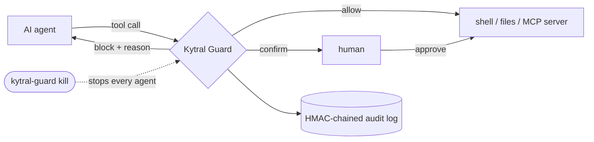

<h1 align="center">Kytral Guard</h1>

<p align="center">
  <b>The anti-catastrophe guard for AI agents.</b><br>
  Kytral Guard blocks destructive actions before they happen.
</p>

<p align="center">
  <a href="https://github.com/Kytral/kytral-guard/actions/workflows/ci.yml"></a>
  <a href="https://www.npmjs.com/package/kytral-guard"></a>
  <a href="LICENSE"></a>
  = 22" src="https://img.shields.io/badge/node-%E2%89%A522-brightgreen">
</p>

<p align="center">
  
</p>

AI agents now run shell commands, migrations, cloud CLIs and MCP tools for you, often with every permission prompt turned
off. One wrong step is enough: `rm -rf ~`, `DROP TABLE users`, `terraform destroy`, a force-push over `main`, an e-mail to
your whole customer list. Kytral Guard sits between the agent and its tools and stops these calls before they run, without
getting in the way of ordinary work.

```console
$ kytral-guard check "rm -rf ~"
BLOCK   rm -r ~ (rule shell-catastrophic)   (preset coding-agent)
$ kytral-guard check "psql -c 'UPDATE users SET plan = NULL'"
BLOCK   update users set plan = null (no WHERE that pins rows) (rule sql-destructive)   (preset coding-agent)
$ kytral-guard check "git push --force origin main"
BLOCK   git push --force/--delete on a shared branch (rule shell-catastrophic)   (preset coding-agent)
$ kytral-guard check "git reset --hard"
CONFIRM git reset --hard (discards uncommitted work) (rule shell-destructive)   (preset coding-agent)
$ kytral-guard check "rm -rf node_modules dist"
ALLOW   no rule matched   (preset coding-agent)
```

## Quick start

```bash
npm install -g kytral-guard
kytral-guard init
```

`init` finds the coding agents installed on the machine (Claude Code, Cursor, Codex, Gemini CLI, Copilot CLI, Windsurf,
Grok Build, Qwen Code, Kimi Code, iFlow CLI, Qoder CLI, CodeBuddy Code, TRAE, opencode, MiMo Code, Factory Droid,
Augment Auggie, Devin CLI, Kiro CLI, Amp, Cline), installs the guard in each and runs a self-test. From now on every shell command, file write and MCP tool call of these
agents goes through Kytral Guard. Catastrophes are refused with an explanation the agent can read; risky but legitimate
commands ask you first; everything else runs as before.

```bash
kytral-guard dashboard                   # a page on this computer: what agents did, what they may do, approvals
kytral-guard check "rm -rf ~"            # what would happen, without running anything
kytral-guard allow "git reset --hard"    # stop being asked for one exact command
kytral-guard kill                        # stop every guarded agent at once (kytral-guard resume to lift it)
kytral-guard doctor                      # check the setup
```

Node.js 22 or later is required. Kytral Guard runs locally: no account, no network call, no telemetry.

## What it catches

| | Blocked (catastrophic) | Asks first (destructive) | Allowed (routine) |
|---|---|---|---|
| **Files** | `rm -rf ~` `/` `.` `*` `.git` `"$DIR/"*`, system paths, `find / -delete`, `dd`/`mkfs`/`wipefs` on disks, Time Machine backups | `rm -rf src`, `find . -name x -delete`, `xargs rm`, `robocopy /MIR` | `rm -rf node_modules dist .next package-lock.json`, `find . -name '*.pyc' -delete`, `rm file.txt` |
| **Git** | force-push or delete of `main`/`master`/`production`, `push --mirror` | `reset --hard`, `clean -f`, force-push of a feature branch, `branch -D`, `checkout .` | `push`, `commit`, `rebase`, `checkout -b` |
| **Databases** | `DROP`, `TRUNCATE`, `DELETE`/`UPDATE` without a restrictive `WHERE`, also via `psql -c`, `mysql -e`, `sqlite3`, `docker exec` or a SQL file they read (`psql -f`); `prisma migrate reset`, `dropdb`, `redis-cli FLUSHALL`, `rails db:drop` in production | `rails db:reset`, `artisan migrate:fresh`, `supabase db reset`, stored procedures, bind parameters | `SELECT`, migrations, `UPDATE … WHERE id = 7` |
| **Infrastructure & cloud** | `terraform`/`tofu`/`pulumi`/`cdk destroy`, `kubectl delete namespace`/`pvc`/`--all`, `aws s3 rm --recursive`, `rds delete-db-instance`, `ec2 terminate-instances`, `gcloud projects delete`, `az group delete` | `terraform apply -auto-approve`, `kubectl delete deployment`, `helm uninstall`, `docker compose down -v`, `curl -X DELETE` | `terraform plan`, `kubectl get/apply`, `aws s3 ls` |
| **System & credentials** | writes to `~/.ssh`, `/etc`, shell rc files, `.git/hooks`; `kill -9 -1`; fork bombs; `format C:`, `vssadmin delete shadows`, `Remove-Item -Recurse C:\` | `shutdown`, `crontab -r`, `iptables -F`, `Remove-Item -Recurse .\src` | everything else |
| **The guard itself** | reading its secret, `kytral-guard resume`/`confirm approve`/`allow`/`uninstall`/`mcp unwrap` from the agent, editing its code or an agent's hook configuration (`.claude/settings.json`, `.cursor/hooks.json`…), `npm uninstall -g kytral-guard` | | `kytral-guard kill` (an agent may stop itself) |
| **Scripts it runs** | a script, `package.json` script, Makefile / justfile / Taskfile recipe, git hook or program (`python x.py`, `node x.js`, `npx tsx x.ts`) that does any of the above | the same, for scoped destruction; a script downloaded and run by the same command | `npm run build`, `make test`, `./scripts/lint.sh` |
| **MCP tools** | the same analysis on every argument of every tool | tools named *delete*, *destroy*, *reset*…; payments and refunds; e-mails to more than 20 recipients | everything else |

A command is not judged alone: what it runs is read from the agent's working directory and analyzed with it. Writing
`rm -rf ~` into `cleanup.sh` and then running `bash cleanup.sh`, `npm run clean`, `make clean` or `git commit` (through a
hook) is refused like the command itself, and so are the local modules a Python or JavaScript program imports, the
here-documents a command feeds to a shell, and variables set in a script (`OUT=/` then `rm -rf "$OUT"`).

What cannot be decided statically is never guessed: `curl … | bash`, `eval "$X"`, a variable in command position, a
bind parameter in a `WHERE` clause or an unparseable SQL write goes to a human. See [docs/policy.md](docs/policy.md) for
every rule.

## How it works



Every call goes through the same checks, in order:

1. **Kill switch**: shared by every agent hook, proxy and SDK guard of the machine; it wins over everything.
2. **Identity** (MCP proxy and SDK): a signed, expiring, revocable badge per agent, bound to one proxy.
3. **Policy**: arguments are normalized (Unicode, homoglyphs, URL and base64 encoding, SQL comments, `CHAR()`, string
   concatenation), then analyzed structurally: SQL through a real parser ([node-sql-parser](https://github.com/taozhi8833998/node-sql-parser)),
   shell commands through a tokenizer that resolves wrappers (`sudo -u root`, `timeout 10`, `env -S`), remote execution
   (`ssh`, `docker exec`, `kubectl exec`), runners (`npx`, `bundle exec`, `python manage.py`) and nested shells, plus a
   PowerShell / cmd.exe analyzer and a catalog of infrastructure, cloud, database and hosting CLIs. The scripts, recipes,
   git hooks and programs a command runs are read and analyzed the same way. Regex rules remain as a safety net.
4. **Human confirmation** when the policy says `confirm`.
5. **Audit**: every decision is appended to a tamper-evident log (HMAC chain and signed tail).

Kytral Guard **fails closed**. An unreadable event, a broken policy, an unwritable audit log or an internal error refuses
the call. The guard bounds its own analysis time so that it never runs into the agent's hook timeout, and where the agent
supports it (Claude Code, Cursor) the hooks are installed so that a crash or a timeout of the guard blocks the call too.

## Integrations

Protection follows the agent, not the model: Claude, GPT, Gemini, Grok, DeepSeek, Qwen, Kimi, GLM or MiniMax models are
checked the same way inside the agents below. Four ways in:

| You use | Kytral Guard plugs in through | Command |
|---|---|---|
| a coding agent (CLI or IDE) | its pre-tool hook | `kytral-guard init` |
| an AI app with MCP servers (Claude Desktop, VS Code, Cline, LM Studio…) | the MCP proxy, wrapped around each server | `kytral-guard mcp wrap` |
| any MCP client (Cherry Studio, Chatbox, n8n…) | the MCP proxy, by hand | [docs/mcp-proxy.md](docs/mcp-proxy.md) |
| your own agent (TypeScript, Python, LangChain, CrewAI, AgentScope, Qwen-Agent…) | the SDK, or `kytral-guard hook generic` | [docs/sdk.md](docs/sdk.md) |

### Coding agents (hooks)

`kytral-guard init` adds a pre-tool hook to the configuration of every agent found (or of the agents named), merged,
with a backup of the previous file. `kytral-guard uninstall <agent>` removes it; `kytral-guard uninstall --all` removes
every hook and takes the proxy off the MCP servers (of the apps, and of the files wrapped with `--file`). Run it before
`npm uninstall -g kytral-guard`: a hook left behind
names a program that is gone, and agents that fail closed then refuse every tool call.

| Agent | Guards | "Ask first" | Notes |
|---|---|---|---|
| **Claude Code** | Bash, PowerShell, Write, Edit, NotebookEdit, Read, MCP tools | yes; refused in `bypassPermissions` / `dontAsk` | the kill switch also ends the agent loop |
| **Cursor** | shell commands, MCP tools, Write and Delete | yes for shell and MCP | `failClosed` set |
| **OpenAI Codex CLI** | Bash, apply_patch, MCP tools | no: refused | trust the hook once in `/hooks` |
| **Gemini CLI** | run_shell_command, write_file, replace, MCP tools | no: refused | |
| **GitHub Copilot CLI** | every tool | yes | |
| **Windsurf (Cascade)** | commands, writes, MCP tools | no: refused | |
| **Grok Build** | run_terminal_command, search_replace, write, read_file, MCP tools | yes (builds since 2026-08-28); refused in `bypassPermissions` | a call it truncates (over 128 KB) needs a human |
| **Qwen Code** (Alibaba) | run_shell_command, write_file, edit, read_file, MCP tools | yes | |
| **Kimi Code** (Moonshot AI) | Bash, Write, Edit, Read, MCP tools | no: refused | restart it after `init` |
| **iFlow CLI** (Alibaba) | run_shell_command, write_file, replace, read_file | no: refused | MCP servers: `kytral-guard mcp wrap iflow` |
| **Qoder CLI** (Alibaba) | Bash, PowerShell, Write, Edit, Read, MCP tools | yes | trust your project folders |
| **CodeBuddy Code** (Tencent) | Bash, PowerShell, Write, Edit, Read, MCP tools | yes | |
| **TRAE**, **TRAE CN** (ByteDance) | RunCommand, Write, Edit, Read, MCP tools | yes | turn hooks on in Settings > Hooks, run them locally |
| **opencode**, **MiMo Code** (Xiaomi) | every tool but searches and plans (a plugin) | no: refused | restart it after `init` |
| **Factory Droid** | Execute, Create, Edit, ApplyPatch, Read, MCP tools | no: refused | trust the folder |
| **Augment Auggie** | launch-process, file tools, MCP tools | no: refused | |
| **Devin CLI** | exec, write, edit, apply_patch, read, MCP tools | no: refused | |
| **Kiro CLI** | execute_bash, file tools, MCP tools | no: refused | its V3 engine, trusted workspaces |
| **Amp** | Bash, shell_command, file tools, MCP tools (a plugin) | yes (Amp's dialog) | |
| **Cline** | every tool but searches and questions | no: refused | a refusal stops the task |
| anything else | `kytral-guard hook generic` or `kytral-guard check`: JSON in, decision out | | [docs/agents.md](docs/agents.md) |

File contents written by an agent are not analyzed as commands (a Makefile may contain `rm -rf build`); their paths are.
Each guarded call costs about 0.15 s.

### MCP servers (stdio proxy)

Wrap any MCP server: the proxy checks every `tools/call` (and every element of a JSON-RPC batch) before it reaches the
server. For the apps of the machine (Claude Desktop, VS Code, Cline, Roo Code, Kilo Code, LM Studio, Continue, or any
JSON or YAML file with `mcpServers`), one command does it:

```bash
kytral-guard mcp list    # which servers are protected
kytral-guard mcp wrap    # run every local server through the proxy (undo: kytral-guard mcp unwrap)
```

By hand (`mcp wrap` does all of this for you), each proxy has its own audience, and the agent gets a badge for it:

```bash
kytral-guard init --no-agents                                      # creates ~/.kytral/secret once
KYTRAL_AUDIENCE=kytral-guard:postgres kytral-guard badge my-agent '*' 1y   # valid one year: every call is refused after
```

```json
{
  "mcpServers": {
    "postgres": {
      "command": "kytral-guard",
      "args": ["--", "npx", "-y", "@modelcontextprotocol/server-postgres", "postgresql://localhost/app"],
      "env": { "KYTRAL_AUDIENCE": "kytral-guard:postgres", "KYTRAL_BADGE": "<the badge printed above>" }
    }
  }
}
```

The proxy adds identity (badges bound to one proxy, revocable), confirmation for tools the server never advertised,
and the server's own `destructiveHint` annotations. A call that needs a human waits for you in `kytral-guard dashboard`
while it is open (or for `kytral-guard confirm approve <id>` from a terminal) and is refused otherwise. See
[docs/mcp-proxy.md](docs/mcp-proxy.md).

### TypeScript SDK

```ts
import { Guard, issueBadge, presetPolicy } from "kytral-guard";

const guard = new Guard({
  policy: presetPolicy("strict"),
  secret: process.env.KYTRAL_SECRET!,          // >= 32 random bytes
  audience: "kytral-guard:billing",
  confirm: async (call, decision) => askOnSlack(call, decision),   // "once" | "deny"
});
const badge = issueBadge(process.env.KYTRAL_SECRET!, "billing-agent", ["refund_payment"], 3600, Date.now(), { aud: "kytral-guard:billing" });
const refund = guard.wrap(badge, "refund_payment", stripe.refunds.create);   // throws GuardError when refused
```

See [docs/sdk.md](docs/sdk.md).

### Plugins

A plugin adds a central policy, a fleet-wide kill switch, remote approvals (Slack, web) for confirmations nobody can answer
locally, or a copy of every decision for your SIEM, to every hook, proxy and SDK guard of a machine. List it in
`KYTRAL_PLUGINS` or `~/.kytral/config.json`. See [docs/plugins.md](docs/plugins.md).

## Policies

Two presets ship with Kytral Guard: **`coding-agent`** (the default for hooks: block catastrophes, confirm scoped
destruction, stay silent on routine work) and **`strict`** (the default for the proxy and the SDK: every destructive
finding is blocked; deletions, payments and mass e-mails are confirmed). Extend one in `~/.kytral/policy.yaml`:

```yaml
extends: coding-agent          # your rules come first, then the preset's
rules:
  - name: protect-production-db
    argMatches: 'prod-db\.internal|DATABASE_URL_PROD'
    action: block
  - name: allow-local-db-reset
    argMatches: '^supabase db reset$'
    action: allow
```

Test a policy without running anything: `kytral-guard check --policy policy.yaml "<command>"` exits 0 (allow), 3 (confirm)
or 2 (block). Reference: [docs/policy.md](docs/policy.md).

## Dashboard

`kytral-guard dashboard` opens a page on this computer, with no account: the command signs you in with a one-time link.
Its **Simple** view says in plain words whether you are protected, what waits for your answer and what happened today
("Codex tried to remove a service running in Kubernetes. It cannot ask you, so it was blocked"), with three protection
levels and a button that stops every agent. Its **Advanced** view has the full log, Block / Ask / Allow for every rule,
exceptions for exact commands, approvals with their complete arguments, and the agents and apps it protects. While it is
open, calls that nobody could answer (MCP servers of your apps, agents that cannot show a prompt) wait for you there
instead of being refused. A catastrophe can never be allowed from the page. It speaks 10 languages (English, French,
Spanish, German, Italian, Brazilian Portuguese, Russian, Japanese, Korean, Simplified Chinese). Details and security
model: [docs/dashboard.md](docs/dashboard.md).

## Kill switch and audit log

- `kytral-guard kill` makes every hook, proxy and SDK guard using this `KYTRAL_HOME` refuse every tool call from their next
  check; pending confirmations are refused at once. `kytral-guard resume` lifts it; it needs the secret, so a forged or
  replayed resume is refused (signed, monotonic generations). A kill is never refused. `kill` exits 0 when the kill is
  written and journaled; 3 when it is written and in force, with a caveat that stderr gives: the audit log could not be read
  or could not record it (`resume` is refused until it can be read; a kill the log did not record rests on
  `kill-switch.json` alone, so run `kill` again once the log is fixed), or `kill-switch.json` held something that could not
  be checked (JSON nested too deep, a FIFO, a device, a folder, which is moved aside) and the kill took its place; 1 when
  nothing could be written (nothing stopped); 2 on a usage error.
- Agent hooks, proxies and SDK guards start from the last kill or resume recorded in the audit log's signed tail marker;
  the marker and every kill and resume in the log sign the id of their log (derived from its real path), so deleting
  `kill-switch.json`, putting back an older resume, or copying in `kill-switch.json`, the log or the marker of another
  `KYTRAL_HOME` that uses the same secret, alone or together, does not lift a kill for one started afterwards. A marker in
  doubt (another home's, an older version's, edited) never lifts one and never lets a resume found in the log count: with
  no kill of this log as recent, every call is refused until a single `kytral-guard resume` (an upgrade from a version
  that signed no id meets it). What still lifts a kill for them: a same-user process that rolls back or deletes this
  home's own `kill-switch.json`, audit log and marker together, which only an anchor off the machine can detect.
  `KYTRAL_HOME` (or `KYTRAL_AUDIT`, or the home folder replaced by a link) redirected to a blank home is like a wipe: the
  kill is lifted for new processes (agent hooks, proxies and SDK guards started afterwards); a proxy (or SDK guard)
  already running keeps the id it started with and stays stopped. An agent able to change the host's environment is
  outside the threat model; `kytral-guard doctor` and the hooks warn about it (a warning, not a block). Grants,
  confirmation requests and decisions, and the kept texts of refused calls are signed for their file too: another home's
  grant nothing here ([docs/threat-model.md](docs/threat-model.md#files-of-another-home)). The guard never waits on its
  files: one replaced by a FIFO, a device or a folder is refused at once, so it cannot hold a hook past the agent's
  timeout (plugin modules excepted: Node loads them). See Limits in [docs/kill-switch.md](docs/kill-switch.md).
- Every decision is appended to `~/.kytral/audit.jsonl`, chained with HMAC-SHA256 and certified by a signed tail marker:
  `kytral-guard audit verify` detects modified, deleted, reordered or truncated entries. Tool arguments are not journaled
  whole: a refusal keeps only its finding (for example the target path of an `rm`, 300 characters at most), and a hook's
  entry the working directory.
  Details: [docs/audit-log.md](docs/audit-log.md).

Every file, variable and default: [docs/configuration.md](docs/configuration.md).

## Security model

Kytral Guard is a control layer, not a sandbox. Read [docs/threat-model.md](docs/threat-model.md) before relying on it.
In short:

- It sees only the calls routed through it (hooks, proxy, SDK).
- It protects against mistakes and naive or prompt-injected destructive commands. A determined process running as the same OS
  user can read its secret or edit its files; for a hard boundary, run the agent as another user or in a container, and
  keep approvals and the kill switch off the machine (Kytral Guard Pro, coming soon: see below).
- Scripts are read when the command is checked. Code loaded another way is not analyzed: files a test runner or a build
  tool picks up on its own, dependencies, programs in other languages, or a script changed between the check and its
  run. Pair the guard with version control and backups.

## Kytral Guard Pro (coming soon)

For teams running agents in production: groups of users with their own rules and approvers, approvals from your phone
or Slack, one kill switch for every machine, central policies, an audit trail anchored outside the machine and
compliance exports, delivered as a plugin and a hosted control plane. It is not available yet: the open-source guard is
complete on its own, and stays so. [Join the waitlist at kytral.com](https://kytral.com).

## Reporting a bug

Open an issue with the **Bug report** form and paste the output of:

    kytral-guard doctor --report                   # add --policy <file> if your proxies are given one

It says which versions run here (Kytral Guard, Node.js, OS), which coding agents run the guard's hook (agent names only,
and what is wrong with a hook in fixed words), which MCP servers Claude Code, Cursor and the AI apps of this machine (Claude
Desktop, VS Code, Cline, Roo Code, Kilo Code, LM Studio, Continue, iFlow CLI) run through the proxy (names only), what the
policies of the proxies and of the hooks hold (rules per decision, `default`, `unknownTools`, the preset they build on),
whether the kill switch is on, and whether there is an audit log (its number of entries). It is built for a public issue
from fixed labels, versions, counts and states only: no secret, key, badge or variable value, no file content, audit entry
or tool argument, no user or host name, no path. A server name is shown only if it is a plain name (a letter or digit, then
letters, digits, `.`, `_` or `-`, 64 characters at most) that does not look like a token and holds no secret of the
environment, user or host name, otherwise `<name>`; `KYTRAL_HOME` is `~/.kytral (default)`, `under ~ (custom)` or
`<path>`; only the `KYTRAL_` variables this version reads are named (any other is counted). It writes nothing. A short
password used as an MCP server name would still be shown, as any plain name is: review the report before posting it.
Plain `kytral-guard doctor` checks the setup for you, with paths and file names as they are: do not paste it into an issue.

A security vulnerability never goes in a public issue: report it privately, as [SECURITY.md](SECURITY.md) explains.

## Contributing

Bug reports, missed catastrophes and false positives are the most valuable contributions: please use the issue forms,
and see [CONTRIBUTING.md](CONTRIBUTING.md). Security issues: [SECURITY.md](SECURITY.md).

## License

[Apache-2.0](LICENSE). "Kytral" and "Kytral Guard" are names of Kytral.
